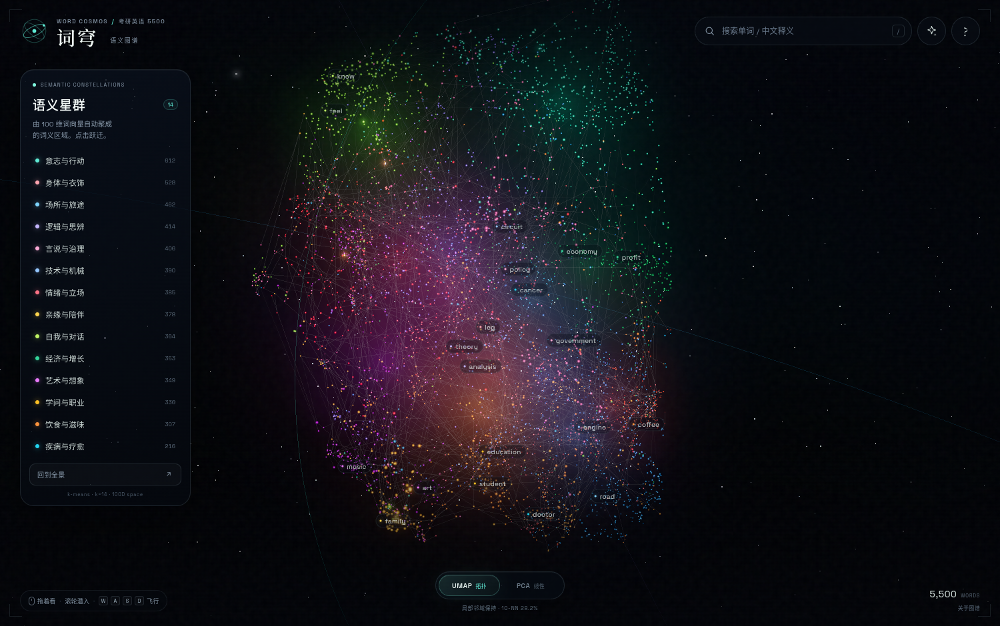

# 词穹 · Word Cosmos

**A navigable 3D semantic atlas of the 5,500-word Chinese postgraduate entrance exam (考研英语) vocabulary.**

Words float through a dark 3D space according to meaning: the closer two words are, the more related they are. Fly through the cloud, search in English or Chinese, open a word card, or jump between the 14 semantic constellations.



## Run it

```bash
npm install
npm run dev
# open the printed URL, usually http://localhost:5173
```

Production build:

```bash
npm run build
npm start          # serves dist/ at http://localhost:4173
```

The app is a static Vite + Three.js site. `public/data/graph.json` is the prebuilt 5,500-word atlas; no server or network is required at runtime.

## Explore

| Action | Control |
| --- | --- |
| Look around | Drag with mouse / one finger |
| Move forward / back | Scroll, or `W` / `S` |
| Strafe / rise / descend | `A` `D` / `E` `Q` |
| Boost | Hold `Shift` |
| Select a word | Click its dot or floating label |
| Search | `/` or the search field — accepts English, 中文释义, or IPA |
| Random word | `R` |
| Close a panel | `Esc` |
| Help & method | `?` button, bottom-right “关于图谱” |

Clicking a constellation focuses the camera, dims every other region, and opens a short description plus representative words. The UMAP ↔ PCA switch morphs all 5,500 points between two different 100D → 3D projections.

## How it is made

```
NPEE word list (5,388) ─┐
ECDICT 考研 supplements ┘→ 5,500 entries
                              │
                     GloVe 100d vectors
                              │
       center · remove top PC · L2 normalise
                              │
                 ┌────────────┴────────────┐
             UMAP → 3D                   PCA → 3D
        (topology-aware)              (linear baseline)
                 └────────────┬────────────┘
                        k-means (k=14)
                              │
                    graph.json + labels
```

- **Words.** 5,388 unique words from the NPEE exam word list, supplemented with 112 high-frequency ECDICT entries tagged `ky` to reach exactly 5,500. Each entry carries phonetic, Chinese senses, POS, BNC/COCA rank, English gloss, and exam tags.
- **Vectors.** Pretrained GloVe `wiki-gigaword-100` (100 dimensions), filtered down to the 5,500 words plus two spelling fallbacks (`appal → appall`, `cigaret → cigarette`). No model is trained locally.
- **Preprocessing.** Mean-centering, removal of the dominant principal component, and L2 normalization. This reduces the frequency bias that otherwise dominates word-vector geometry.
- **Projection.**
  - **UMAP** (nNeighbors=22, minDist=0.08, nEpochs=700, 3 components) preserves local neighborhoods and gives the explorable constellation layout.
  - **PCA** projects directly onto the three largest variance axes. It is included as an honest linear baseline (3-D variance explained: **13.58%**).
  - 10-nearest-neighbor recall against the 100D space: **UMAP 28.2%**, **PCA 3.8%** (random baseline ≈ 0.18%). The app surfaces these numbers so the tradeoff is visible rather than hidden.
- **Constellations.** k-means with k=14 in the 100D space. Cluster names and landmark words were curated after inspecting each centroid's nearest words. Full details are in `scripts/cluster-meta.json`.

### Rebuilding the data

Downloads approximately 195 MB and runs in about 2 minutes (UMAP is the slow part):

```bash
npm run fetch-data
```

Pipeline:

- `scripts/fetch-data.sh` downloads the NPEE word list, ECDICT CSV, and GloVe vectors into `data/raw/`.
- `scripts/build-data.mjs` parses and filters the data, projects to 3D, clusters, computes neighbors, and writes `public/data/graph.json`.
- `scripts/relabel.mjs` can re-apply names/landmarks from `scripts/cluster-meta.json` without recomputing projections.

## Project layout

```
index.html                 UI shell, help dialog, loader
src/main.js                search, word/cluster panels, familiarity, orchestration
src/atlas.js               Three.js scene, shaders, camera flight, labels, picking
src/style.css              visual system and responsive layout
public/data/graph.json     5,500 words + positions + neighbours + clusters
scripts/build-data.mjs     reproducible data pipeline
scripts/cluster-meta.json  curated constellation names, colours, landmarks
docs/preview.png           screenshot
```

Familiarity marks (陌生 / 眼熟 / 掌握) are stored only in `localStorage`.

## Built with

- [Three.js](https://threejs.org/) — WebGL rendering, bloom, custom point shader
- [UMAP-js](https://github.com/PAIR-code/umap-js) — dimensionality reduction
- [Vite](https://vite.dev/) — dev/build tooling
- [Space Grotesk](https://github.com/floriankarsten/space-grotesk) via Fontsource — Latin display face; Chinese uses the system Noto Sans/Serif CJK stack

## Data credits

- **ECDICT** — English–Chinese dictionary by skywind3000, MIT licensed. https://github.com/skywind3000/ECDICT
- **NPEE word list** — from `mahavivo/english-wordlists`, assembled from the public postgraduate entrance exam syllabus. https://github.com/mahavivo/english-wordlists
- **GloVe** — Jeffrey Pennington, Richard Socher, Christopher Manning; public domain vectors. https://nlp.stanford.edu/projects/glove/
- **UMAP** — McInnes, Healy, Melville. UMAP-js is Apache-2.0.

The source code in this repository is MIT licensed. The dictionary and embedding data remain subject to their respective upstream terms.
